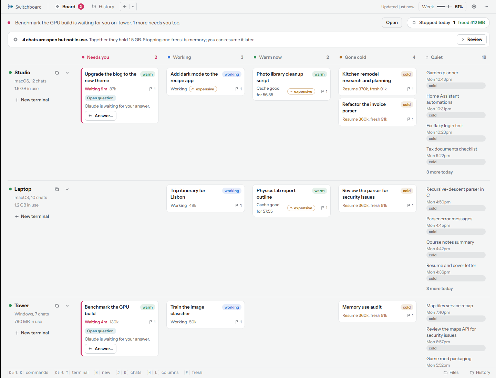
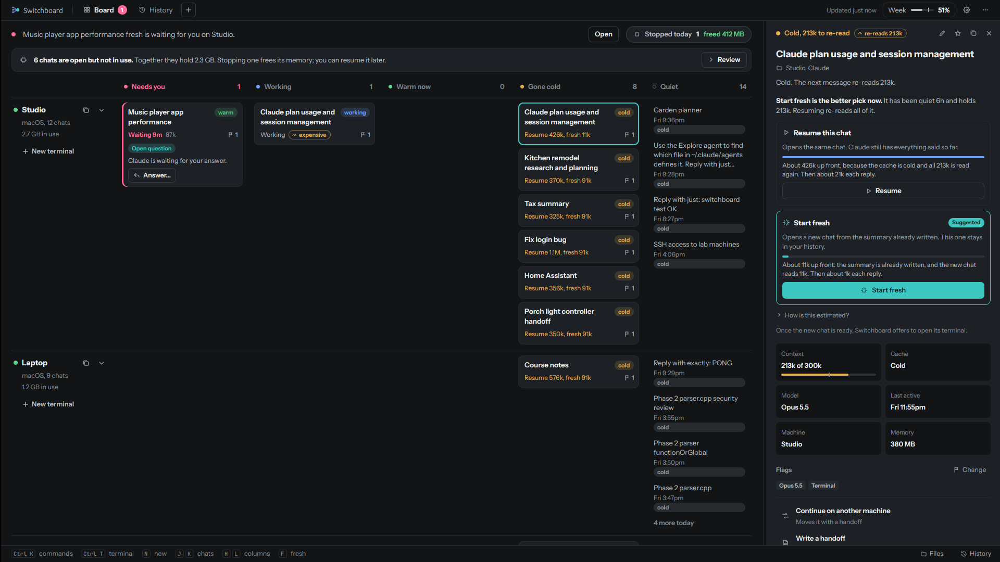

# The board

Each computer gets a row. Each chat sits in a column by what it needs from you, and drifts right as it cools.

<figure markdown>
{ .shot }
{ .shot }
</figure>

## The columns

| Column | What puts a chat there |
|---|---|
| Needs you | Claude is waiting for an answer, or Switchboard is [holding a message](chats.md#the-guard-for-big-cold-chats) you typed. A chat that has waited more than a day is **parked**: it stays here, muted and at the bottom, and stops counting toward the badge and notifications |
| Working | Claude is working. A chat with no progress for 6 hours says **Stalled** |
| Warm now | Quiet, with its cache still warm, so a reply is cheap. The one about to go cold is first |
| Gone cold | Quiet, its cache has run out, and it is big (150k tokens or more), so the next message reads it all again |
| Quiet | Everything else, one line each, newest first: small chats gone cold (with a **cold** pill), chats whose cache isn't known yet, stopped chats. Each computer keeps its 8 newest here however old they are, so a chat from three days ago is still here until 8 newer ones push it to History (**N more in History**). The column grows to fit them and never scrolls |

The server decides each chat's state once, and the board, the terminal tabs, the details and the iPhone all show
that same answer. [What warm and cold mean](chats.md#warm-and-cold)

## Sent by Claude

A chat can send a task to another computer, where a new background chat does it and reports back. Those are not
your chats, so on the desktop they stay out of the columns and out of every count. Each computer's row ends with
one line instead, **Sent by Claude 7**, with how many are working and how many have finished.

Click the line to open it. Each task has a row: where it stands (Working, Done and whether its report was read,
Stopped without a report), which chat sent it (click to go to that chat), and **Stop** or **Clear**. The chat
that sent tasks says so in its details: "2 tasks out: 1 working, 1 done".

- **It only asks for you when it must.** A sent task reports to the chat that sent it, so a question in its report
  is not yours to answer. It moves to **Needs you**, marked **Sent by Claude**, only while it is stopped at a
  prompt that only you can answer, such as a permission. The notification then says "A task Claude sent is
  waiting".
- **It cleans up after itself.** Two minutes after a task finishes, Switchboard stops its process, unless you
  opened it in a tab, marked it **Keep running**, or it is busy again. The report is kept, and **Resume** brings
  the chat back.
- **It leaves the board soon after.** A finished task moves to History 10 minutes after its report is read, or
  after a day when nobody read it. In History it carries the same mark, and the **All chats** filter can show
  only your chats or only the ones Claude sent.
- **Move to my chats** in a task's details makes it one of yours from then on: it sits in the columns, counts
  like any chat, and is no longer stopped for you.

The mark survives a rename, Start fresh, a resume and a handoff.

## A card

- **The name**, its tag (UltraCode, Max effort), its tab group's dot, and a star.
- **One line for where it stands:** "Waiting 14m", "Message on hold", "Cache good for 4:12" (amber in the last
  minute), "Resume 290k, fresh 91k" for a cold chat, "Idle", "Stopped to free memory".
- **expensive** on a chat of 150k tokens or more, or **re-reads 312k** once it's cold (outside Gone cold, where
  the status line already says it).
- **The flags button** at the right edge: how many launch flags it has (model, effort, Chrome, permissions...).
  Click it to change them.
- **Gray text with "As of 2m ago"** when its computer hasn't reported for 45 seconds. Old information looks old.

Click a card to open its details on the right. Double-click it to open its terminal. Right-click it for every
action, each with what it would cost.

## Answer from the board

A chat in **Needs you** shows what Claude is asking, with a tag for the kind of question:

| Tag | What you get |
|---|---|
| **Choose** | Claude's options and the one it recommends. When there is a clear pick, one click on the card sends it |
| **Questions** | One row of choices per question, or type your own |
| **Do this, then confirm** | Numbered steps, **Done**, and **Hit a problem...** |
| **Fix setup** | A button that fixes it, like restarting the chat with Chrome |
| **Open question** | A box to type your answer |

The card's button answers right away when it can. Otherwise **Answer...** opens the details with the full
controls, where you can also untick any of Claude's assumptions that are wrong. **Send** opens the chat's terminal
and types your answer in.

Where the question comes from: Claude Code's own question to you, when it asked one. Otherwise, with
**Summarize waiting chats** on (Settings, AI and your Claude setup), Claude sums up what the chat's last message
asks; with it off, the card shows the chat's own words.

## The top line

Above the board, one line tells you what to look at first, in this order: a chat that needs you; a big chat about
to go cold ("goes cold in 3 min. Reply soon to keep it cheap"); usage burning faster than usual; the 5-hour window
or the week running high; otherwise how the week is going. Its button (**Open**, **Reply now**, **Plan details**)
takes you there.

## A computer's row

The row's label shows the computer's system and how many chats it has, how much memory Claude is using there, and
what it can do when it shares that (Xcode, an Android SDK, a GPU). **New terminal** starts a new chat on that
computer. An offline computer says so, and its chats come back when it does.

## Tidy up

Chats that sit open and do nothing still hold memory, about half a gigabyte each. Switchboard stops the ones
that cost nothing to stop, and asks about the rest.

**Stopped by itself.** A chat that finished its reply and has been left alone for 6 hours is stopped to free its
memory. One replaced by a newer chat or archived in the Claude app waits just as long. Its card says **Stopped to
free memory**, and **Resume** (or opening it) brings it back where it was. By then its cache has run out, so
resuming costs what replying to it would have cost anyway. A stopped chat can't be reached from the Claude phone
app or claude.ai until you resume it in Switchboard. A chat is never stopped
this way while it's working, waiting on you, running a subagent, a background command or a scheduled task, or
while another chat waits on it; nor when it's starred, marked **Keep running**, or open in a terminal (a tab, even
while the app is closed, or `claude attach` on its computer). Its own computer checks once more at the moment of
the stop, and leaves it alone if anything is running, if it can't tell, or if the chat was resumed or restarted
within the wait. Change the wait, or turn this off, in **Settings > Chats > Stop idle chats**.

A finished task that [Claude sent](#sent-by-claude) is stopped sooner, two minutes after its report: it was never
yours to keep open.

**Asked about.** For the others, a strip under the top line says **N chats are open but not in use**, with how
much memory they hold. **Review** lists them; **Stop** each one, **Stop all**, **Keep** the ones you want, or
**Not now**. These stop only when you click Stop (twice: the first click turns into **Confirm stop**).

What it asks about: background chats idle for 3 days, ones that say they're working but have done nothing for
12 hours, chats replaced by a newer one or archived in the Claude app, and leftover Claude processes with no chat.
Never a chat you marked **Keep running** or starred, one waiting on your answer or holding a message for you, one
that is working, or one open in a terminal tab, even while the app is closed.

A stopped chat stays under **Stopped today** for a day, and **Resume** brings it back where it was.
