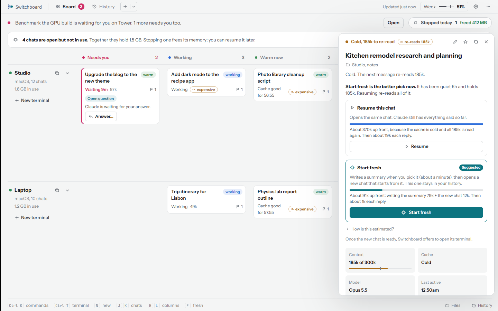
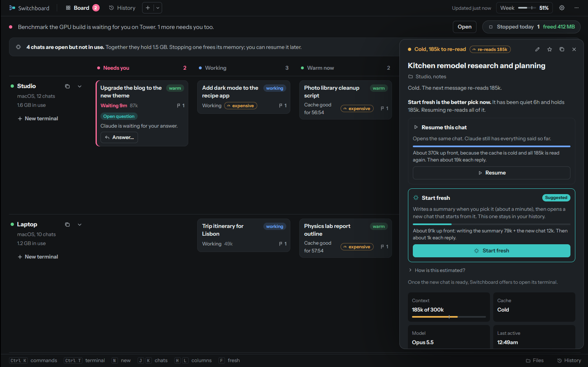
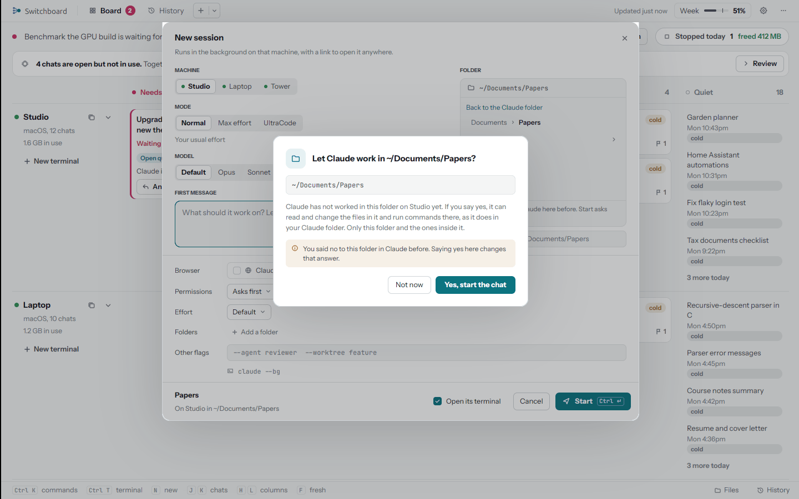
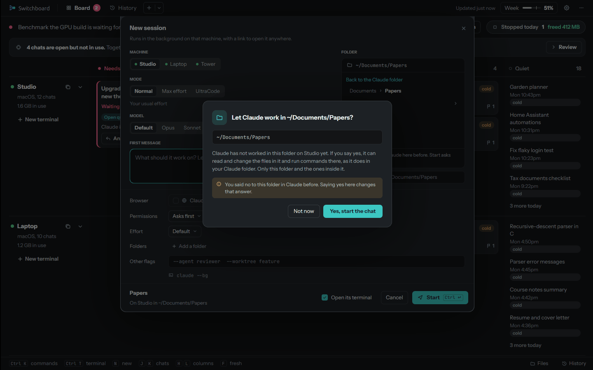

# Chats and what they cost

## Warm and cold

Claude keeps a chat cheap while its **cache** is warm: the next message reads the chat from the cache at a tenth of
the price. Claude Code's cache lasts **5 minutes or 1 hour** after each reply. Once it runs out, the chat has
**gone cold**, and the next message reads the whole chat again at full price.

Switchboard measures each chat's cache from Claude Code itself (its status line, or how long the chat's cache has
lasted before), and never guesses. A card says **Cache good for 4:12** while it's warm; a chat whose cache isn't
known yet says **cache ?**.

| Size | Cold, going back... |
|---|---|
| **Under 60k tokens** | is cheap anyway. Resume |
| **60k to 150k** | reads it all again. Start fresh is cheaper if you don't need the whole history |
| **150k or more** | reads it all again at full price, and the guard holds your message first |

## In a chat's terminal

The strip at the top of a terminal says two things, each in its own place:

- **On the left, what the chat is doing:** Needs you (and what Claude asked), Working, Message on hold, Stalled,
  or Idle.
- **On the right, its cache:** **Warm 4:12** while it's warm (amber in the last minute), **Cold, re-reads 290k**
  once it's run out, or **Cache ?** when it isn't known yet. A chat that needs you still says whether it's warm.

Beside the cache, **Start fresh** does the same Start fresh as the details. A small box first says what it does
(and what it costs, when that's known); confirm, and the terminal moves on to the new chat when it's ready. It
isn't there while Claude is working. The iPhone shows the same: the cache chip and **Start fresh** under the
chat's title, which asks the same way.

Claude Code's own status line at the bottom of the terminal redraws every 15 seconds, so its **warm 42m** or
**cold 3h** stays true while nobody types.

## Resume or start fresh

For a quiet chat, the details compare two ways back, and mark one **Suggested**.

<figure markdown>
{ .shot }
{ .shot }
</figure>

- **Resume** goes back to the chat as it is. Warm, that's cheap. Cold, it reads every token again.
- **Start fresh** writes a summary of the chat on its computer, then opens a new chat in the same folder with just
  that summary. The summary keeps every instruction you gave, word for word, and points to the old chat in case
  Claude needs more. The old chat moves to **Replaced**, and the new one is named after it with "(part 2)".

The suggestion follows a few rules, in order: a working chat gets none (open its terminal instead); a held
message suggests Start fresh; a warm chat, Resume; a chat within a tenth of where Claude Code compacts it anyway
(270k or more when chats compact at 300k), Start fresh; otherwise whichever costs less. Where chats compact is
[Compact long chats at](settings.md#context-window) in Settings.

??? question "How are the costs estimated?"
    In tokens, weighted by API prices: reading from the cache counts 0.1, writing the cache 1.25 (5-minute cache)
    or 2 (1-hour cache), plain input 1, and output 5. Your plan may weigh them differently, so they are
    estimates.

    - **Resume:** the whole chat, read from the cache (warm) or written to it again (cold).
    - **Start fresh:** writing the summary (a condensed copy of the chat: your messages and Claude's replies,
      without tool output, plus about 2,000 tokens of summary) and the new chat reading that summary. When a summary
      written after the last reply already exists, it is used again for free.

    The details' **How is this estimated?** link shows the numbers for that chat.

Summaries are written by **Opus**, or **Sonnet** if you pick it in **Settings, Chats** ("Sonnet is quicker
and costs less of your plan"). Writing one takes about a minute. If the chat is still working, Switchboard asks
first: start fresh when it finishes, or now, which stops it.

## The guard for big cold chats

A message typed into a chat of **150k tokens or more** whose cache has gone cold is **held**, so it doesn't read
the whole chat again by surprise. In the terminal you see what it would cost, and two ways on:

- **Start fresh** (cheaper): type `/clear`, then send anything. Switchboard writes a summary, loads it in a new
  chat and carries your message over.
- **Keep going:** send the same message again, or type `go`, within 15 minutes.

On the board the chat moves to **Needs you** with **Message on hold**, and its details offer **Send anyway** and
**Start fresh**. Commands starting with `/` are never held.

## Start a new chat

++n++ on the board, **New terminal** on a computer's row, or the command palette opens **New chat**.

<figure markdown>
{ .shot }
{ .shot }
</figure>

| | |
|---|---|
| **Machine** | Any computer that's online, or **Auto** |
| **Folder** | The folder picked, with its full path; **Choose...** to browse the computer's folders (below), a recent one in one click, or a new one |
| **Mode** | **Normal**, **Max effort** (deepest reasoning on every turn) or **UltraCode** (multi-agent workflows for big builds, on Opus at extra high effort; uses your plan faster) |
| **Model** | **Default**, or the models your computers' Claude Code takes |
| **Effort** | Default, Low, Medium, High, Extra high |
| **Permissions** | **Machine default** (whatever that computer's own Claude Code settings say), Asks first, Accept edits, Plan, Auto, Bypass, Never asks |
| **Browser** | Claude in Chrome |
| **Tools** | **Auto**, or pick tools from your [library](settings.md#library) |
| **Folders** | Up to 8 extra folders Claude may work in, each added with the same chooser |
| **Other flags** | More Claude Code flags, from the ones Switchboard passes on: an agent, a worktree, extra instructions, allowed and disallowed tools, a fallback model and the like. The field says so when a flag isn't one of them |
| **First message** | What it should work on, or empty to start idle. Your draft is kept for a week |

**Save setup** keeps a combination of these by name; **Last used** brings back the last one, and **Defaults**
goes back to nothing picked. On the desktop the last setup's effort, permissions, browser and other flags are
filled in when the window opens. Extra folders belong to the computer they were picked on, so changing the
computer clears them. Leave **Open its terminal** checked to watch it start.

**Asks first** is sent by name to a computer whose Switchboard is up to date. An older one starts the chat in
that computer's own default mode instead.

### Choosing a folder

**Choose...** opens the computer's folders the way Finder or File Explorer shows them: its places down the side
(Recent, the Claude folder, Home, Desktop, Documents and the rest when the computer allows it, and places added
there), Back, Forward and Up, a path bar to jump to any folder above, and the folder's contents with files greyed
out. A click picks a folder and a double-click opens it; **Choose** (or Enter) takes the folder picked, or the one
open, and Esc cancels. On the iPhone it is the same browser as Files: tap into folders, then **Choose** at the
bottom.

### Auto

**Auto** picks the computer for you. By default it goes by rules: a computer with what the task needs (Xcode for
iOS, an Android SDK, a GPU, Windows, going by words in your message), then one with a connected phone, then one
that has the repository your message names, then the one with the most free memory. A chat that uses Claude in
Chrome goes to its Chrome computer. Only computers that share what they can do (Settings, Machines) take part.

With **Let Claude pick for Auto** on (Settings, AI and your Claude setup), Claude makes the pick from your task
and each computer's tools, free memory and repository names, and falls back to the rules if it can't.

### A folder Claude hasn't worked in

Before Claude works in a folder outside the Claude folder for the first time, Switchboard asks you, the same
question Claude Code would: **Let Claude work in this folder?** If you say yes, Claude can read and change the
files in it and run commands there, in that folder and the ones inside it.

## Change a chat's flags

**Flags** (on a card, in its details, its right-click menu and its terminal's bar) shows what a chat runs with
and lets you change it.

- **Changes live:** the model, the effort, turning plan mode on, and extra folders are typed into the chat.
  Nothing restarts.
- **Needs a relaunch:** permissions, Claude in Chrome, computer use and other flags are read when Claude Code
  starts, so the chat relaunches and carries on with its history. It keeps everything else it was started with,
  including a pinned model version.
- A **worktree** is set when a chat starts and can't be changed afterwards.
- A chat open in a terminal of its own can't be typed into or relaunched from here. You get one command to run
  in that terminal instead.

Resume and Start fresh also keep what the chat ran with: its model, effort, permission mode, extra folders,
agent, extra instructions and Chrome setting.

## Continue on another computer

**Continue on another machine** (++c++, or **Continue on <computer>** in a card's menu) writes a summary on this
computer and starts the chat on another one, in the same folder, with the same model, effort, permission mode,
agent, extra instructions and Chrome setting. Extra folders come along when the other computer has them too.
The old chat shows **Continued on <computer>**.

## Names

A new chat is named from its first few words, or, with **Name new chats** on, by Claude from its first message.
**Rename chat** (or double-click the name, or the tab's title) changes it everywhere at once: the tab, the board,
the details, History, the iPhone, and Claude Code's own `/resume` list. Clear the name to go back to the automatic
one.
