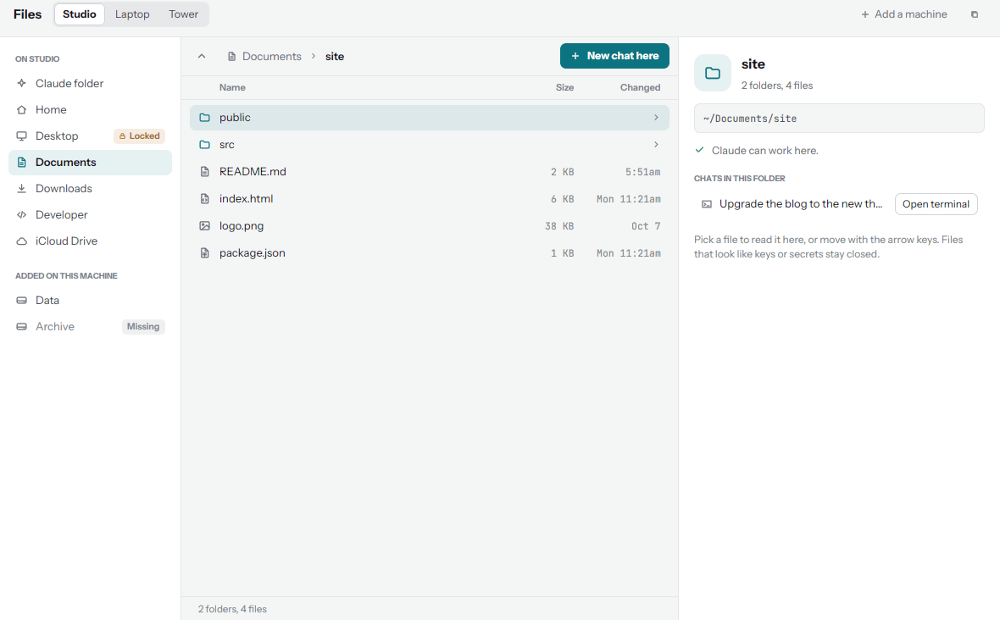
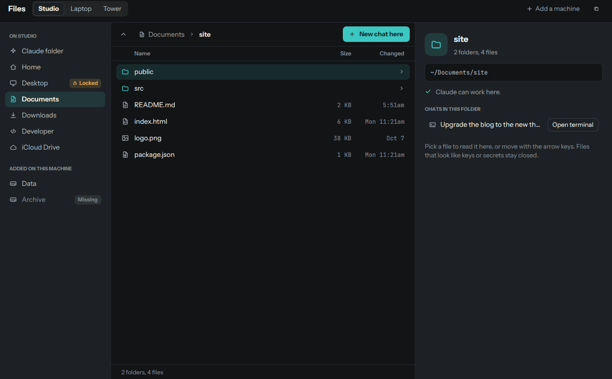

# Files

Last validated: Nov 22, 2026

Files lets you look through the folders on any of your computers without opening a terminal there. You can read
a text file, find the chats that work in a folder, and start a new chat in it.

{ .shot }
{ .shot }

## Benefits

- **Every computer in one window**: switch between your computers' folders with one click.
- **Start where the work is**: **New chat here** starts a chat in the folder you're looking at, on that computer.
- **See who is working there**: each folder lists the chats that use it, with their terminal one click away.
- **Private things stay private**: hidden files and private folders are never listed, and files that look like
  keys or secrets are never opened.

## Use cases

- **Check a result**: read the file a chat just wrote on another computer.
- **Point a chat at a file**: paste a file's path into a chat instead of typing it.
- **Find a project**: look for the folder a project lives in before you start a chat there.

## How it works

Files shows what a small helper on each computer reports. The helper is the part of Switchboard that runs on
every computer you add. It lists a folder or reads the start of a file only when you ask for it, and nothing is
copied to the home computer or kept after you close the window.

The helper decides what it's willing to show. An app can name only a folder under one of that computer's places,
and the helper refuses hidden and private folders whatever the app asks for. For more information, refer to
[Places and folders](../concepts/places-and-folders.md).

## Use Files

1. Open Files and pick a computer.
2. Pick a place and move through its folders.
3. Preview a file.
4. Start or open a chat in the folder.

### Prerequisites

Before you can browse a computer, you must:

- Have the computer on the board and online. Refer to [Add your computers](../machines.md).

### Open Files and pick a computer

Select **Files** in the footer of the board, or press ++cmd+k++ (++ctrl+k++ on Windows and Linux) and select
**Files**. Files opens in a window of its own. Pick the computer at the top of the sidebar.

### Pick a place and move through its folders

The sidebar lists the computer's places. A place is a folder that Switchboard may open on that computer.

| Place | When it shows |
|---|---|
| **Claude folder** | Always |
| **Home**, **Desktop**, **Documents**, **Downloads** | While **Anywhere in home** is on for the computer, and the folder exists |
| **Developer**, **Projects**, **Code**, **src**, **repos** | The same, for the ones that exist in the home folder |
| **iCloud Drive** | The same, on a Mac |
| Places under **Added on this machine** | When someone added them at that computer |

The middle of the window lists the folder's folders first and then its files, with **Name**, **Size** and
**Changed**. Use the arrow keys to move and ++enter++ to open a folder. ++left++ or ++cmd+up++ goes to the folder
above.

Each folder also says whether Claude may work in it:

- **Claude can work here.**
- **Claude hasn't worked here yet. A new chat here asks you first.**
- **You said no to Claude here before. A new chat here asks again.**

### Preview a file

Select a file to read it on the right, or press ++space++ for a quick look. Files shows the first 64 KB of a
text file and says **Showing the start of the file** when there is more. A file that isn't text has no preview.

### Start or open a chat in the folder

- **New chat here** opens the new chat sheet with this computer and this folder already picked.
- **Chats in this folder** lists up to six chats that work in the folder, each with **Open terminal** or
  **Resume**. A line under them says how many more there are.
- **Paste the path** puts the selected file's path into one of those chats, in quotes when the path has a space.

## What Files never shows or opens

| What | What Files does |
|---|---|
| Files and folders whose names start with a dot, such as `.ssh`, `.config`, `.env` and `.claude` | Never listed |
| `~/Library` on a Mac, except iCloud Drive | Never listed |
| `AppData`, `Application Data` and `Local Settings` on Windows | Never listed |
| Symbolic links | Never listed and never followed |
| Files that look like keys or secrets | Listed, but never opened |

A file looks like a key or a secret when:

- its name starts with `id_rsa`, `id_dsa`, `id_ecdsa` or `id_ed25519`;
- its name ends in `.key`, `.pem`, `.p8`, `.p12`, `.pfx`, `.jks`, `.keystore`, `.kdbx`, `.ovpn`, `.asc` or `.gpg`;
- its name contains `secret`, `credential`, `password` or `token`;
- its contents start like a private key, whatever its name.

These rules are enforced on the computer that holds the files, not in the app. This is because a rule the app
enforced could be skipped by another app.

## Limitations

- Files only reads. It can't edit, move, delete, upload or download a file.
- A preview is the first 64 KB of a text file.
- A folder lists up to 400 folders and 400 files.
- Folders outside the home folder show only as a place added at that computer.
- A computer that is offline can't be browsed.

## Troubleshooting

### A place says No permission

macOS hasn't let the helper read that folder. Select **Open the switch on** followed by the Mac's name, turn the
switch on at that Mac, then select **Check again**. For more information, refer to
[Places and folders](../concepts/places-and-folders.md).

### A place says Missing

The folder was moved or renamed on that computer, or it's on a drive that isn't plugged in. Plug the drive in, or
select **Open the Claude folder**.

### Only the Claude folder shows

**Anywhere in home** is off for that computer. Select **Open Settings** in Files and turn it on, or keep it off
and add the folders you need as places at that computer.

### A folder looks empty

Files says **Nothing in this folder** when everything in it is hidden: dot files and private folders don't show.
On a Mac, a folder you haven't given permission for can also look empty, and Files says so.
