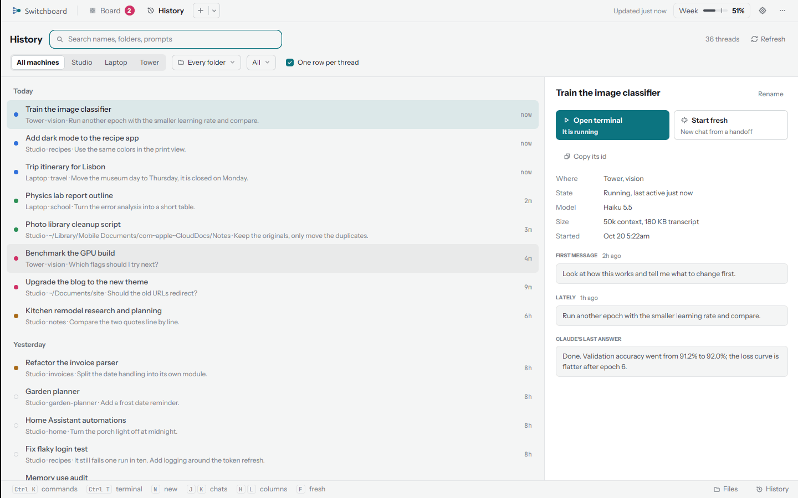
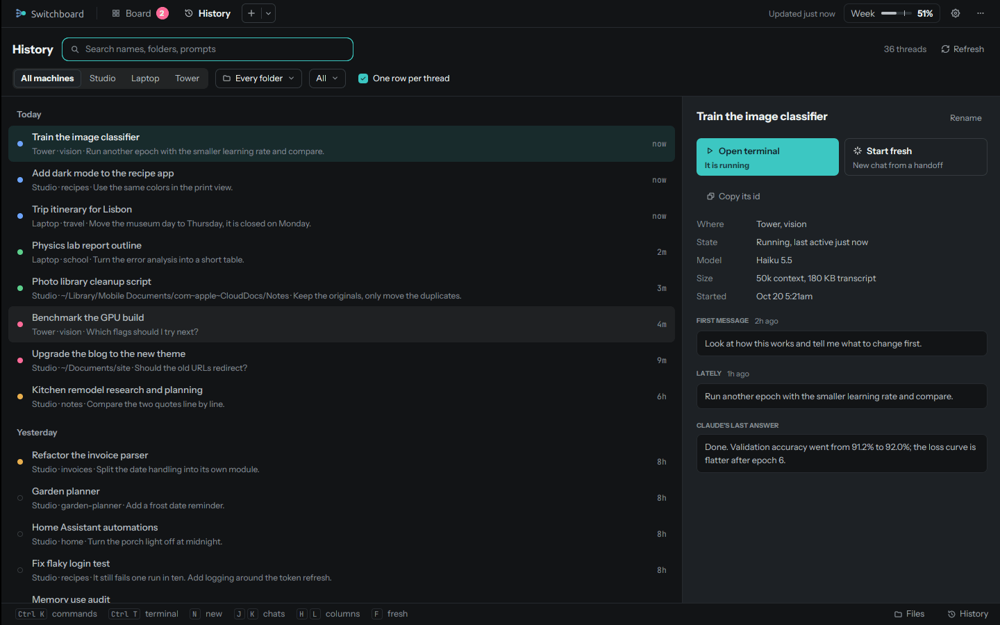

# History

Last validated: Nov 22, 2026

History lets you find any chat you've had on any of your computers and go back to it. It lists every chat,
newest first and grouped by day, including the ones that left the board long ago.

{ .shot }
{ .shot }

## Why it matters

The board shows what is going on now. A chat you finished last week is no longer there, and Claude Code's own
list of old chats only covers the folder and the computer you run it in.

## Benefits

- **One list for every computer**: a chat on the laptop and a chat on the computer in the closet are in the same
  list.
- **Search by what you said**: History searches names, folders and the words of your first and latest messages.
- **Read before you reopen**: a chat's details show how it began, how it ended and its summary, so you can tell
  whether it's the one you want before you spend anything on it.
- **Nothing is lost**: Switchboard never deletes a chat from History.

## Use cases

- **Pick up old work**: find the chat where you fixed something last month and resume it, or start fresh from its
  summary.
- **Follow a long task**: a chat that was continued several times is one thread, and its earlier chats are listed
  under the newest one.
- **Check what Claude did by itself**: filter to the tasks that chats sent to other computers.

## How it works

Each computer keeps its own chats. The home computer, which is the one of your computers that runs Switchboard,
asks every computer for its list and keeps an index of names, folders, sizes and the first and latest message of
each chat. History searches that index.

The text of a chat stays on its computer. When you select a row, Switchboard reads that chat's first message, its
latest messages, Claude's last answer and its summary from the chat's computer, so that computer has to be
online for you to see them.

## Use History

1. Open History.
2. Search and filter the list.
3. Select a chat to read about it.
4. Go back to the chat.

### Open History

Press ++cmd+b++ (++ctrl+b++ on Windows and Linux), or select **History** in the footer of the board. History
opens as the tab next to the board.

### Search and filter the list

Type in **Search names, folders, prompts**. Every word you type has to match, in any order. A word can match a
chat's name, its folder, your first or latest message, its computer's name or its model.

The filters above the list narrow it further.

| Filter | Choices | Default |
|---|---|---|
| Computer | **All machines**, or one computer | **All machines** |
| Folder | **Every folder**, or one folder | **Every folder** |
| State | **All**, **Running**, **Quiet**, **Stopped**, **Archived**, **Replaced** | **All** |
| Whose | **All chats**, **Your chats**, **Sent by Claude** | **All chats** |
| **One row per thread** | On or off | On |

The states mean:

- **Running**: the chat is running now, whether Claude is working, waiting or idle.
- **Stopped**: a background chat that isn't running. **Resume** brings it back.
- **Archived**: the chat was archived in the Claude app.
- **Replaced**: a newer chat continues it, after **Start fresh** or after it moved to another computer.
- **Quiet**: none of the above.

A thread is a chat together with the newer chats that continued it. With **One row per thread** on, a thread
shows as one row for its newest chat that matches your search. The list loads a page at a time, and **Show
more** loads the next page. **Refresh** reads the list again.

### Select a chat to read about it

Select a row. The details on the right show:

- **Where**, **State**, **Model**, **Size** and **Started**: the computer and folder, when it was last active,
  how much context it holds and how large its transcript is.
- **First message** and **Lately**: your first message and your latest ones.
- **Claude's last answer**.
- **Summary**: the summary Switchboard wrote for the chat, when there is one.
- **Additional history**: the earlier chats of its thread, newest first. Select one to open it the same way.

**Rename** changes the chat's name everywhere, and **Copy its id** copies the chat's id.

### Go back to the chat

| Button | What it does |
|---|---|
| **Resume** | Starts the chat again where it stopped. Under it, **Re-reads 290k** says how much Claude reads again |
| **Open terminal** | Resumes the chat and opens its terminal. For a running chat this is the first button, and it says **It's running** |
| **Start fresh** | Opens a new chat from a summary of this one. The old chat stays in History |
| **Open in Claude** | Opens the chat's page on claude.ai, when it has one |
| **Compact into one chat** | For a thread: writes one summary of all its chats and opens a new chat from it. The old chats stay |

**Compact into one chat** shows what it will cost before it starts. Select **See what it costs**, then confirm.

For more information about choosing between resuming and starting fresh, refer to
[Resume or start fresh](resume-or-start-fresh.md).

## Limitations

- A chat's messages and summary can be read only while its computer is online. The list itself still shows the
  chat.
- Search covers a chat's name, folder, first message and latest message, not every message in between.
- **Compact into one chat** reads the 40 newest chats of a thread.
- History can't delete a chat.

## Troubleshooting

### A chat is missing from the list

1. Clear the search field and set every filter back to its default.
2. Turn off **One row per thread**. The chat may be an earlier part of a thread, listed under **Additional
   history** of a newer chat.
3. Select **Refresh**. A computer that was offline adds its chats when it's back.

### "Couldn't read the chat"

The chat's computer didn't answer. Check that it's online on the board, then select the row again.
