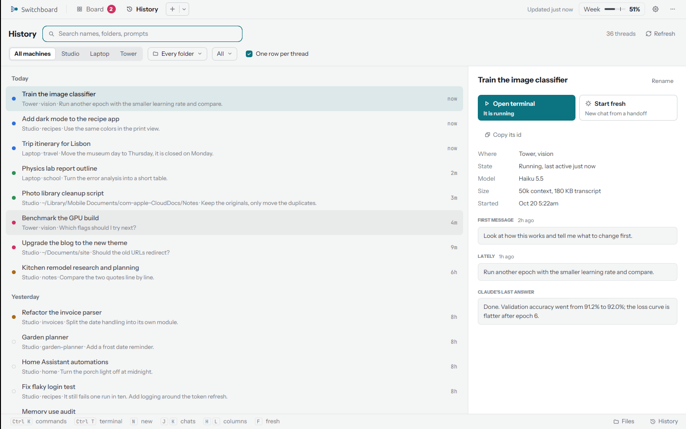
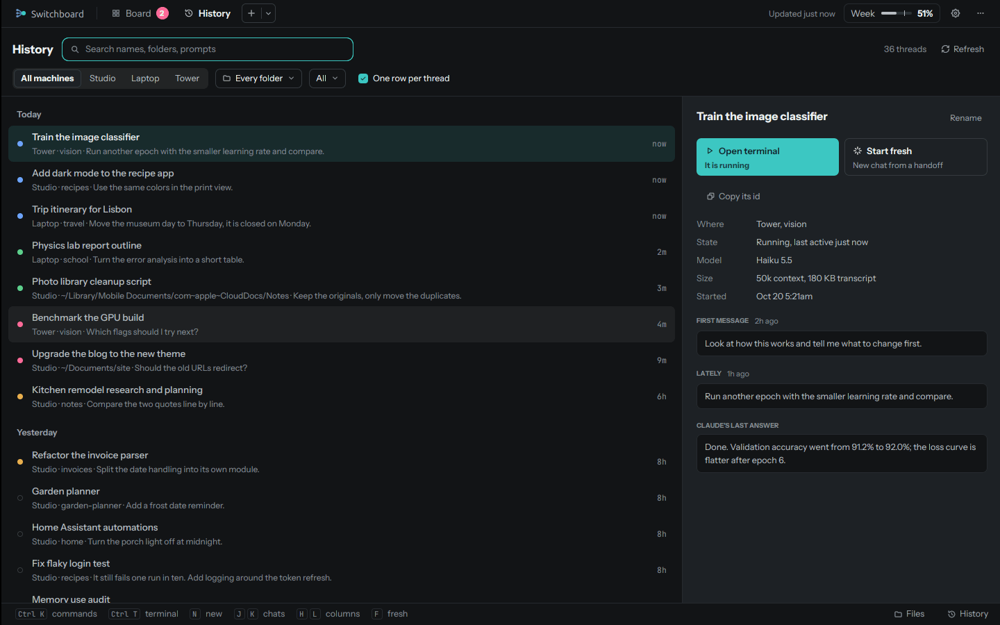
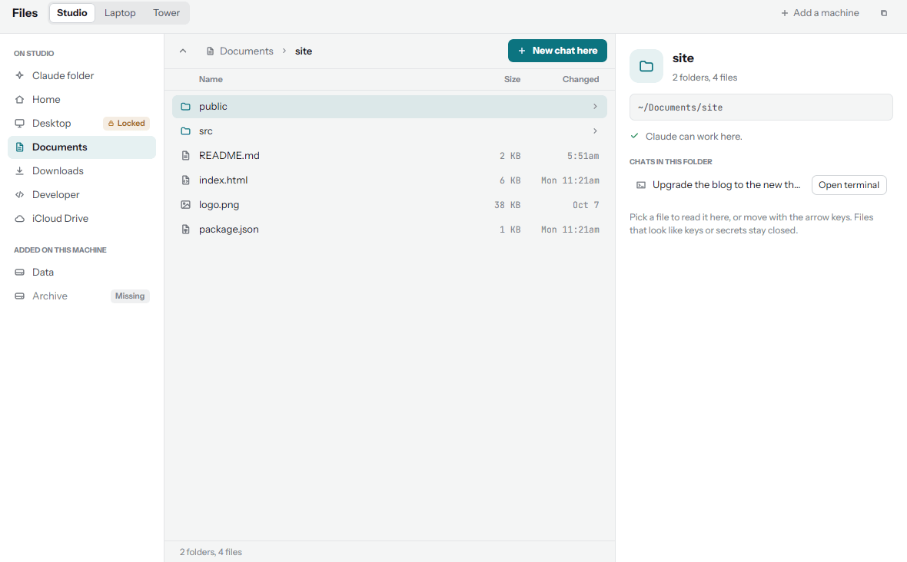
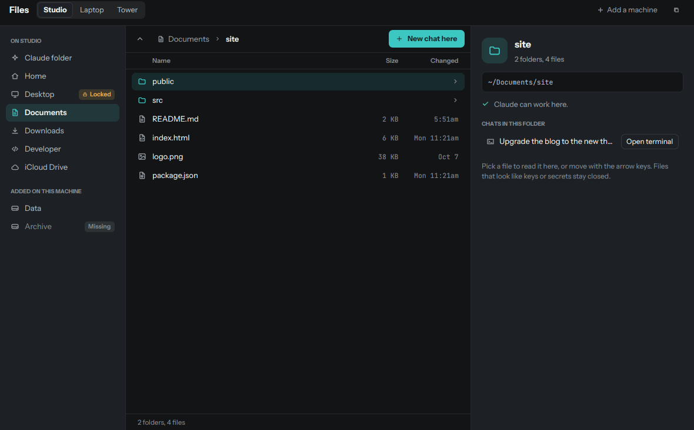

# History and files

## History

++cmd+b++ opens **History**: every chat on every computer, newest first, by day.

<figure markdown>
{ .shot }
{ .shot }
</figure>

- **Search** names, folders and prompts. Every word you type has to match.
- **Filter** by computer, by folder, and by state: Running, Quiet, Stopped, Archived or Replaced.
- **One row per thread** folds a chat that was continued in newer ones (by Start fresh or Continue) into its
  newest part.

Select a chat to see where it ran, its state, model and size, its first and latest messages, Claude's last answer,
its summary when one was written, and the earlier chats in its thread. From there:

| Button | What it does |
|---|---|
| **Resume** | Go back to it (or **Open terminal** if it's running) |
| **Start fresh** | A new chat from a summary of this one |
| **Open terminal** | Resume it in a terminal |
| **Open in Claude** | Its page on claude.ai, when it has one |
| **Compact into one chat** | One summary of every chat in the thread, and a new chat from it. The old chats stay |

Nothing in History is ever deleted.

## Files

**Files** (in the command palette, or on a computer's row) browses the folders on any of your computers.

<figure markdown>
{ .shot }
{ .shot }
</figure>

- **Places** on the left, per computer: its Claude folder, then (when the computer allows anywhere in its home
  folder) Home, Desktop, Documents, Downloads, common code folders like Developer, Projects and Code, iCloud Drive
  on a Mac, and the places added with [`sb.py places add`](commands.md#sbpy-the-helper).
- **A folder's files** in the middle, with a preview of a text file (its first 64 KB) and quick look
  (++space++).
- **The chats in that folder** on the right, with **Open terminal** or **Resume**, **New chat here**, and **Paste the
  path** to put a file's path into a chat.

Each folder says whether Claude can work there, or will ask first.

### What Files never shows or opens

- **Hidden files and folders:** anything whose name starts with a dot (`.ssh`, `.config`, `.env`, `.claude`...).
- **Private folders:** `~/Library` (except iCloud Drive), `AppData`, `Application Data`, `Local Settings`.
- **Links:** symbolic links are never followed.
- **Keys and secrets** are listed but never opened: names like `.env*`, `id_rsa` and `id_ed25519`, files ending
  in `.key`, `.pem`, `.p8`, `.p12`, `.pfx`, `.jks`, `.keystore`, `.kdbx`, `.ovpn`, `.asc` or `.gpg`, any name
  with `secret`, `credential`, `password` or `token` in it, and any file that starts like a private key, whatever
  its name.

Folders outside the home folder are reachable only through a place added on that computer itself; the server and
the app can never add one.

!!! note "macOS: No permission"
    macOS asks before an app reads Desktop, Documents or Downloads. A place that says **No permission** needs that
    switch turned on, on that Mac, for the program running the helper. Files shows how.
