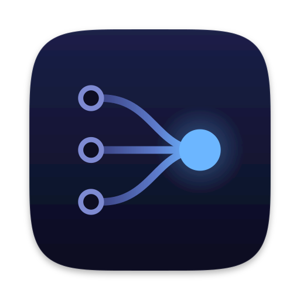
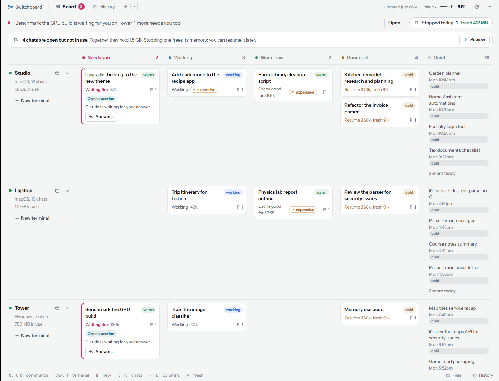
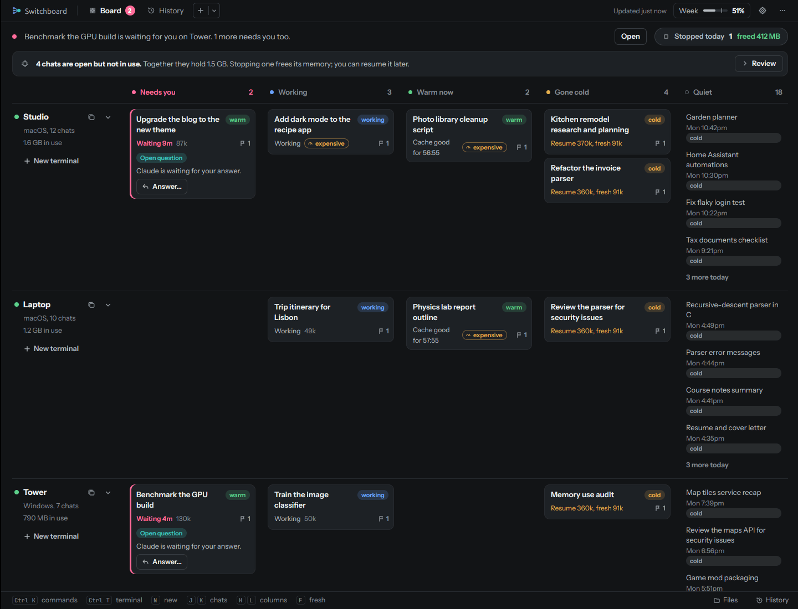

<div class="sb-hero" markdown>



# Switchboard

<p class="sb-tagline">One board for the Claude Code chats on all your computers.</p>

<p class="sb-sub">See which chats need you, answer them, open their terminals and start new ones, on whichever
computer you pick. It runs on your own machines, with no account and no cloud service.</p>

[Install Switchboard](install.md){ .md-button .md-button--primary }
[Download the app](https://github.com/nicglazkov/switchboard/releases/latest){ .md-button }

<div class="sb-pills">
  <span class="sb-pill">macOS</span>
  <span class="sb-pill">Windows</span>
  <span class="sb-pill">Linux</span>
</div>

<div class="sb-board" markdown>
{ .shot }
{ .shot }
</div>

</div>

## Why it exists

You run Claude Code on a desktop, a laptop and a box in the closet. Each chat lives in its own terminal on its own
machine, and the one that is waiting for you is never the one in front of you. Switchboard gathers them all into
one window, and tells you what each one would cost to go back to.

<div class="grid cards" markdown>

-   :material-view-dashboard-outline:{ .lg .middle } **Everything on one board**

    ---

    Each computer gets a row, each chat a column by what it needs:
    <span class="sb-pill need">Needs you</span> <span class="sb-pill run">Working</span>
    <span class="sb-pill warm">Warm now</span> <span class="sb-pill cold">Gone cold</span>.
    Answer a question right from its card.

    [:octicons-arrow-right-24: The board](board.md)

-   :material-cash-clock:{ .lg .middle } **Know the cost before you go back**

    ---

    A cold chat reads its whole history again on the next message. Switchboard compares resuming it with starting
    fresh from a summary, and suggests the cheaper one.

    [:octicons-arrow-right-24: Chats and what they cost](chats.md)

-   :material-console:{ .lg .middle } **Terminals from anywhere**

    ---

    Open any chat's terminal in a tab, even when its computer is behind another router. Tabs, groups, names and
    your own shells too.

    [:octicons-arrow-right-24: Terminals](terminals.md)

-   :material-rocket-launch-outline:{ .lg .middle } **Start a chat on any computer**

    ---

    Pick the machine (or let Auto pick), the folder, the model and the effort. Switchboard starts the chat there
    and opens its terminal.

    [:octicons-arrow-right-24: New chats](chats.md#start-a-new-chat)

-   :material-history:{ .lg .middle } **History and files**

    ---

    Every chat on every computer, searchable. Browse each computer's folders and start a chat right where you are.

    [:octicons-arrow-right-24: History and files](history-files.md)

-   :material-gauge:{ .lg .middle } **Keep an eye on your plan**

    ---

    5-hour, weekly and 4-week usage at a glance, a daily budget that tells you when a day runs over, and a hard
    limit if you want one.

    [:octicons-arrow-right-24: Usage and budget](usage.md)

</div>

## Set up in three steps

<ol class="sb-steps" markdown>
<li markdown>**Install the server** on a computer that stays on, with one line:

```sh
curl -fsSL https://github.com/nicglazkov/switchboard/releases/latest/download/get-server.sh | bash
```
</li>
<li markdown>**Add your computers.** Setup shows a one-time code and a line to paste on each Mac, Linux or Windows
computer where you use Claude Code. [More](machines.md)</li>
<li markdown>**Open the app** on the computers you look at the board from. On your home network it finds the server
by itself. [Get the app](apps.md)</li>
</ol>

[Read the full install guide :octicons-arrow-right-24:](install.md){ .md-button }

## Private by design

<div class="grid cards" markdown>

-   :material-home-lock-outline:{ .lg .middle } **Runs on your own computers**

    ---

    No account to make, nothing to sign up for, and no usage data sent anywhere. Your chats, files and history
    stay on your network.

-   :material-check-decagram-outline:{ .lg .middle } **Signed updates**

    ---

    The app installs only builds signed with the release key, and checks each file's SHA-256 before it installs
    it. Updates wait until you say so.

</div>

[Privacy and security :octicons-arrow-right-24:](privacy.md)

<small>Switchboard is free software under the [GNU AGPL-3.0](https://github.com/nicglazkov/switchboard/blob/main/LICENSE).
It is not made by or affiliated with Anthropic. Claude and Claude Code are trademarks of Anthropic.</small>
