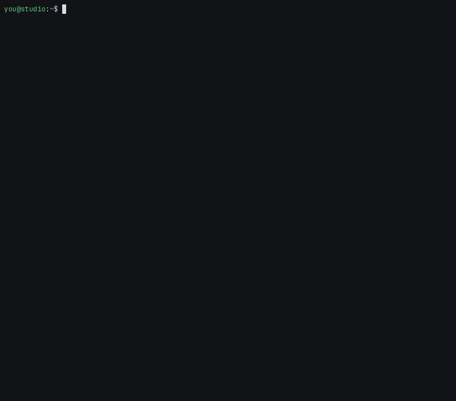
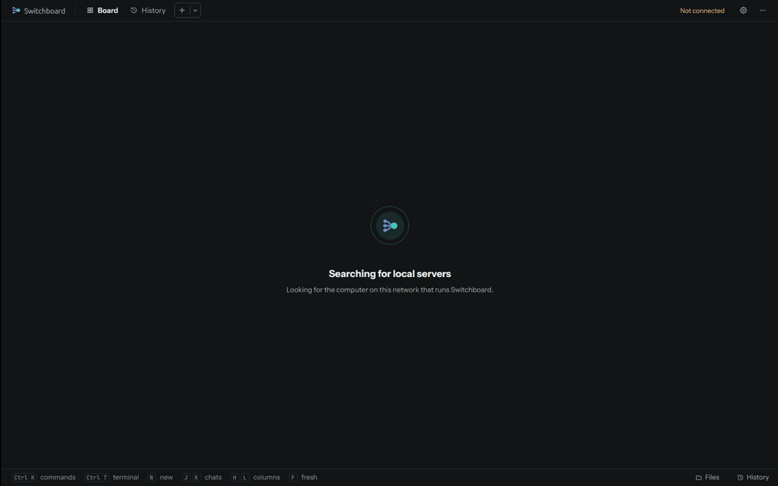

# Install Switchboard

Switchboard has three parts:

<div class="grid cards" markdown>

-   :material-server-outline:{ .lg .middle } **The server**

    ---

    On one computer that stays on: a Mac mini on a shelf, a desktop that never sleeps, a small Linux box. It keeps
    the list of your computers and chats, so the board is there even when your laptop is closed. If you only have
    one computer, it can be the server too.

-   :material-lan-connect:{ .lg .middle } **The helper**

    ---

    On each computer where you use Claude Code: `sb.py`, a small Python program that is Claude Code's status line
    and hooks, and `switchboard-node`, which links the computer to the server.

-   :material-monitor-dashboard:{ .lg .middle } **The app**

    ---

    On the computers you look at the board from: Mac, Windows or Linux. It talks only to your server.

</div>

Setup takes three steps, about ten minutes in all.

## What you need

| | Server | Each Claude Code computer | The app |
|---|---|---|---|
| **System** | macOS or Linux (best), or Windows with [less](#a-windows-server) | macOS, Linux or Windows | macOS 11 or newer, Windows, or Linux x86_64 |
| **Python** | 3.9 or newer | 3.9 or newer | not needed |
| **Claude Code** | not needed | installed and signed in | not needed |

Macs have Python once the command line tools are installed (`xcode-select --install`). Most Linux systems come
with it. On Windows, run `winget install -e --id Python.Python.3.12`.

!!! warning "Keep it on your own network"
    Your devices reach the server on ports **8130** (the apps), **8131** (downloads for adding computers) and
    **8132** (terminals and linked computers). A home network and [Tailscale](https://tailscale.com) both work.
    Switchboard has no passwords: anyone who can reach those ports can use it. Never forward them to the internet.
    [Why, and what is protected](privacy.md#no-passwords-on-purpose)

## 1. Install the server

=== "One line (Mac or Linux)"

    On the computer that stays on, in a terminal:

    ```sh
    curl -fsSL https://github.com/nicglazkov/switchboard/releases/latest/download/get-server.sh | bash
    ```

    It downloads the server kit from the newest release, checks its SHA-256, and runs the installer from it.
    Options for the installer go after `bash -s --`:

    ```sh
    curl -fsSL https://github.com/nicglazkov/switchboard/releases/latest/download/get-server.sh | bash -s -- --no-hub
    ```

=== "From the desktop app"

    On a Mac or Linux computer that will be the server, open the app. When it finds no server on the network, pick
    **Run the server on this computer**. It checks the computer (Python, the ports, a server already there), then
    installs the server from the copy inside the app, as you, with no administrator password. When it is done
    the app connects to `http://localhost:8130`.

    The Windows app doesn't carry the server, so on Windows use the PowerShell line instead.

    Run `switchboard setup` in a terminal afterwards to add your other computers.

=== "From a copy of the repository"

    ```sh
    git clone https://github.com/nicglazkov/switchboard.git
    cd switchboard
    scripts/install/install-server.sh
    ```

    Without a ready-made hub (`native/dist/switchboard-hub-<os>`), the installer builds it with
    [Rust](https://rustup.rs), or installs without it when Rust is missing.

=== "Windows"

    In PowerShell, in a copy of the repository:

    ```powershell
    git clone https://github.com/nicglazkov/switchboard.git
    cd switchboard
    powershell -ExecutionPolicy Bypass -File scripts\install\install-server.ps1
    ```

    See [A Windows server](#a-windows-server) for what works there.

The installer needs no `sudo` and changes nothing outside your own account. It:

- puts the server in `~/.local/share/switchboard/app`;
- uses a ready-made hub, or one you give it with `--hub-binary`, or builds it with Rust;
- sets up three services that start when you log in: the server (8130), the downloads (8131) and the hub (8132).
  These are systemd user services on Linux and LaunchAgents on macOS;
- adds the `switchboard` command (`~/.local/bin/switchboard`);
- runs first-run setup.

In a terminal it first checks the machine: the system, Python, whether ports 8130 to 8132 are free, systemd user
services and linger, disk space, and whether it runs on a battery. Then it shows each step with how long it took.
The output of the commands it runs goes to `~/.local/share/switchboard/logs/install.log`; when a step fails, it
shows that step's last lines. At the end it lists the addresses to use, with a QR code when `qrencode` is
installed.

<figure markdown>
{ .shot width="760" }
</figure>

!!! tip "Linux: keep running after you log out"
    systemd stops user services when you log out. To keep Switchboard running, run this once:
    `sudo loginctl enable-linger $USER`

### Installer options

| Option | What it does |
|---|---|
| `--hub-binary PATH` | Use this `switchboard-hub` instead of a ready-made or built one |
| `--node-dir DIR` | Copy the `switchboard-node` builds for other systems from this folder into the downloads |
| `--no-hub` | Install without the hub: no terminals and no linking with a code; computers are added over ssh |
| `--no-service` | Don't set up services; start everything in the background instead |
| `--no-start` | Install, but start nothing |
| `--no-setup` | Skip first-run setup (run `switchboard setup` later) |
| `--yes`, `-y` | Ask nothing, and skip first-run setup (run `switchboard setup` later) |
| `--plain` | Plain `== <step>` lines instead of the checklist (also with `NO_COLOR` or when the output is not a terminal) |
| `--uninstall` | Take the server out (see [Uninstalling](#uninstalling)) |

`get-server.sh` itself takes `--kit URL|FILE` (a kit somewhere else, or `SWITCHBOARD_KIT_URL`) and
`--sha256 HEX`; everything else goes to the installer.

### Host your own kit

The server kit is a tarball of `server/`, `agent/sb.py`, `scripts/install/`, the ready-made hub and node builds,
the Rust sources for the hub, and python-zeroconf (so a Linux server without avahi still announces itself on the
network). Each release has one. To make your own, in a copy of the repository:

```sh
scripts/install/pack-server-kit.sh --base https://<your server>/<folder>
# writes dist/server-kit/: switchboard-server-kit.tar.gz, its .sha256, and get-server.sh
```

Put the three files in that folder on any web server, then on the new server machine run
`curl -fsSL https://<your server>/<folder>/get-server.sh | bash`. With no web server at all, copy the kit and
`get-server.sh` over and run `bash get-server.sh --kit switchboard-server-kit.tar.gz`.

`pack-server-kit.sh` also takes `--out DIR`, `--no-binaries`, `--no-sources` and `--no-vendor`.

### A Windows server

A Windows server reaches computers over ssh only. The hub, which carries terminals and linking with a code, doesn't
run on Windows yet, so there are two logon tasks instead of three services (the server on 8130 and the downloads
on 8131), and the installer needs the OpenSSH client. It prints a firewall rule for ports 8130 and 8131 to run as
administrator. `install-server.ps1` takes `-NoStart`, `-NoSetup` and `-Uninstall`.

If you can, put the server on a Mac or a Linux computer. Any Windows PC can still be one of your computers.

## 2. First-run setup

Setup runs at the end of the installer. Run it again any time with `switchboard setup`. It asks three things.

<ol class="sb-steps" markdown>
<li markdown>**The server's address.** This is what the app and your other computers use to reach the server. It
lists the addresses it finds: this machine on your network, its Tailscale name if Tailscale is running, and its own
name. Pick one, or type another. The Tailscale name works away from home too.</li>
<li markdown>**Your computers.** Add each computer where you use Claude Code, with a one-time code (recommended) or
over ssh. [Add your computers](machines.md) explains both.</li>
<li markdown>**Each computer's Claude folder.** This is where new chats start and where folders are picked from.
Setup lets you browse the computer's folders, starting from its home folder. Change it later in Settings,
Machines.</li>
</ol>

## 3. Open the app

Install the app on the computers you look at the board from. [The apps](apps.md) has the details for each system.

| | |
|---|---|
| :material-apple: **Mac** | [`Switchboard-<version>.dmg`](https://github.com/nicglazkov/switchboard/releases/latest): open it, then drag Switchboard to Applications or open **Install Switchboard**. |
| :material-microsoft-windows: **Windows** | [`Switchboard-Setup-<version>.exe`](https://github.com/nicglazkov/switchboard/releases/latest): installs for your account only, with no admin password. |
| :material-linux: **Linux** | [`Switchboard-linux-x86_64.tar.gz`](https://github.com/nicglazkov/switchboard/releases/latest): unpack it and run `Switchboard`. |

On the same network as the server, the app finds it by itself and connects. Otherwise it asks for the address you
picked in setup, such as `192.0.2.10` or a Tailscale name.

<figure markdown>
{ .shot width="760" }
</figure>

Once connected, the server tells the app every address it has: its network addresses, its `.local` name and, when
Tailscale is running on the server, its Tailscale address and name. The app keeps them, so if you connect once at
home, it also works away from home over Tailscale, with nothing to type. Settings, Machines, Server addresses lists
what it keeps and lets you remove any of them.

!!! note "Finding the server on Linux"
    A server installed from the kit announces itself on the network with what the kit carries. One installed from
    a copy of the repository on Linux needs `avahi-utils` or `python3-zeroconf` for that.

## Updating

The **app** updates itself: when a new release is out it offers **Restart to update** or **Install on quit**.
[Updates](updates.md) explains how.

To update the **server**, run the one line from [step 1](#1-install-the-server) again, or `git pull` and run the
installer again. Your computers, settings and history stay.

## Uninstalling

```sh
curl -fsSL https://github.com/nicglazkov/switchboard/releases/latest/download/get-server.sh | bash -s -- --uninstall
```

From a copy of the repository, `scripts/install/install-server.sh --uninstall` does the same. On Windows, `install-server.ps1 -Uninstall`. This removes the services, the server, the downloads and the
`switchboard` command, and keeps your settings and history: delete `~/.config/switchboard` and
`~/.local/share/switchboard` too if you don't want them.

On each computer, `python3 ~/.claude/switchboard/sb.py uninstall` takes the helper out of Claude Code's settings,
removing only what it added.
