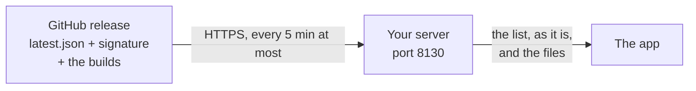

# Updates

## The app

The app checks for a new version about a minute and a half after it opens, then once a day. **Settings, Updates,
Check now** checks right away. When there is one, the header offers it with two buttons:

- **Restart to update** downloads it, installs it and opens the new version.
- **Install on quit** downloads it and installs it the next time you quit.

Nothing is downloaded or installed until you pick one, and a stopped download picks up where it left off. The update panel's **What's new** opens the release's notes, and
**About, What's new** in the app lists every version's changes (the same list as the [changelog](changelog.md)).

### Where updates come from



The app asks your server, never the internet. The server reads the newest release of
[nicglazkov/switchboard](https://github.com/nicglazkov/switchboard/releases) on GitHub and passes on its list of
builds and their files.

### Why you can trust an update

Each release has `latest.json`, which lists every build with its size, SHA-256, version and build id, and
`latest.json.sig`, an Ed25519 signature of that list. The app:

1. checks the signature with the public key built into it, and ignores a list that is not signed with the
   release key;
2. offers only a build whose version is not older and whose build id is newer, so nothing can roll it back to an
   older one;
3. checks the downloaded file's size and SHA-256 against the signed list, and deletes it if either is wrong.

So neither your server nor GitHub can change what the app installs.

### If the new version doesn't start

The app keeps the old version until the new one has run for 20 seconds or quit cleanly. If the new one crashes
or won't start, the next launch puts the old one back and opens it, and that build is not offered again. The swap
touches only the app, never your settings.

!!! info "Settings, Updates says it couldn't look"
    The server couldn't reach GitHub, or the release has no list yet. The message says which. The app tries again
    the next day, or when you press Check now.

### Builds without updates

Updates need the public key built into the app. A build you make yourself without `SB_UPDATE_PUBKEY` has updates
off, and Settings, Updates says so. [Building and releasing](building.md#updates) explains how to sign your own
releases.

### Your own download page

A server whose `~/.config/switchboard/downloads.json` names a download page (`{"url": "http://..."}`) reads the
list there instead of GitHub; `native/scripts/publish.sh` makes such a page. `SWITCHBOARD_RELEASES=owner/name`
makes the server read another GitHub repository's releases, and `SWITCHBOARD_RELEASES=off` turns the GitHub look
off.

## The server

Run the install line again on the server:

```sh
curl -fsSL https://github.com/nicglazkov/switchboard/releases/latest/download/get-server.sh | bash
```

Or, in a copy of the repository, `git pull` and run `scripts/install/install-server.sh` again. The installer
swaps the new server in and keeps your computers, settings and history. The downloads it serves on port 8131 are
then the new version's, so computers you add afterwards get the matching helper.

## The helper on each computer

To update a computer's helper, get a new code with `switchboard setup --code` on the server and run the
`install-agent` line it prints, adding `--update` (`-Update` in PowerShell) so the installer replaces `sb.py`
too. (The shorter line the app shows never replaces a helper that is already there.)

```sh
curl -fsSL http://<server>:8131/install-agent.sh | bash -s -- --server <server> --code <code> --update
```
