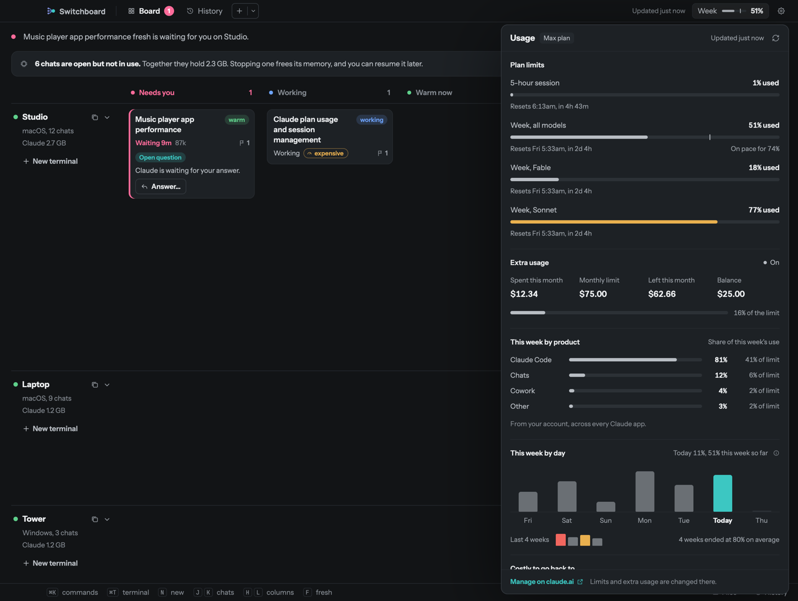

# Usage and budget

The **Week** chip in the header opens **Usage**.

<figure markdown>
{ .shot }
{ .shot }
</figure>

| | |
|---|---|
| **5 hours** | How much of the 5-hour window you've used, and when it resets. **Not reported on this plan** when your plan has no 5-hour window |
| **This week** | How much of the week, when it resets, and where you'll end at this rate |
| **Last 4 weeks** | The average of how the last four weeks ended |
| **This week by day** | A bar for each day since the reset, with today in color: amber over your daily budget, red at the hard limit |
| **Costly to go back to** | The biggest cold chats (150k tokens or more), with what they would re-read |

The numbers are your plan's own, as Claude Code reports them in its status line on each computer. Each chat only
knows what its last reply saw, so Switchboard takes the highest number any chat has seen in the current window:
use only goes up until the window resets. They move when a chat replies, so what you use in the Claude apps shows
up a little later, and numbers more than ten minutes old say how old they are. After a reset, the tiles show
**--** until the next reply.

Switchboard assumes all your computers are signed in to one Claude account. With two accounts, it follows the one
whose week ends last.

A day runs from midnight to midnight in the server's time zone. If the server runs somewhere else, set
`SWITCHBOARD_TZ` on it (for example `America/Los_Angeles`).

## Daily budget

**Settings, Budget** sets how much of the week a day should use. The default, 14.3%, spreads the week evenly over
seven days. When a day reaches it, Switchboard tells you, and each chat mentions it to you once that day.

In the last 48 hours before the weekly reset, the budget **gives way**: a day may use whatever room is left
divided by the days left, when that is more than the budget. So the last days of a week can use what earlier days
saved. Before that, the budget is exactly what you set.

A **5-hour cap** does the same for the 5-hour window (off unless you set one). It never gives way, and it clears
when the window resets. On a plan that reports no 5-hour window it cannot be checked, and the usage summary says so.

## Hard limit

Off unless you turn it on, in **Settings, Budget, Hard limit**, with a daily limit (20% to start) and an optional
5-hour limit (off until you set one). The daily limit gives way in the last 48 hours before the weekly reset, the
same way the budget does; the 5-hour limit never does. When a limit is reached:

- new messages in every chat are blocked, with a line that says why and how to lift it;
- running background chats are stopped, once a day. They can be resumed. Chats open in a terminal are left
  running, and their next message is blocked;
- your iPhone gets **Hard limit hit**, if notifications are set up.

**Lift for today** turns it off until midnight in the server's time zone. If you undo the lift, new messages are
blocked again, but no more background chats are stopped that day.
