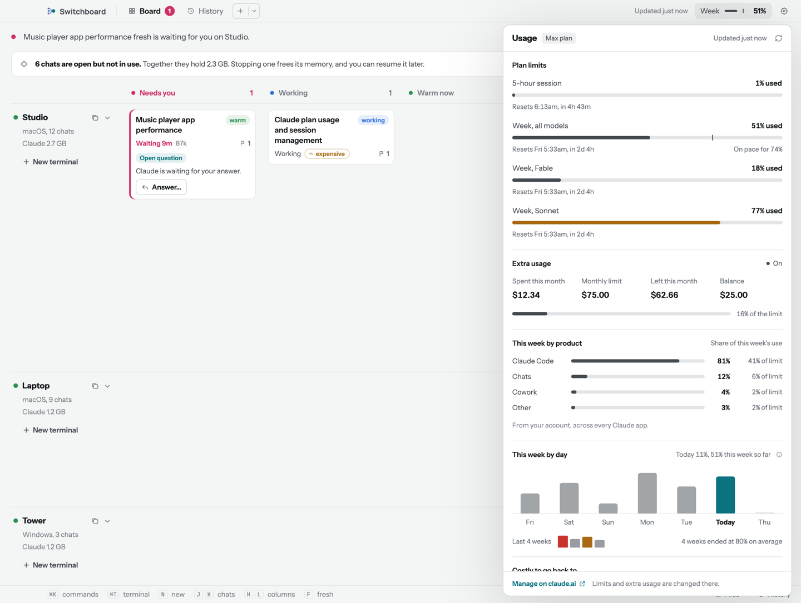

# Usage and budget

The **Week** chip in the header opens **Usage**.

<figure markdown>
{ .shot }
{ .shot }
</figure>

| | |
|---|---|
| **Plan limits** | A bar for each limit your plan has: the 5-hour session, the week for all models, and the week for a single model when your plan has one. Each says how much is used and when it resets, as a time and as how long from now: **Resets Tue 9pm, in 6d 20h**. The week also says where you'll end at this rate. A plan with no 5-hour window says **not reported on this plan** |
| **Extra usage** | On or off, what you've spent this month, your monthly limit, what is left under it, and a prepaid balance if you have one |
| **This week by product** | How the week's use splits between Claude Code, chats in the Claude apps, Cowork and the rest, and each one's share of the weekly limit |
| **This week by day** | A bar for each day since the reset, with today in color: amber over your daily budget, red at the hard limit. Under it, how the last four weeks ended |
| **Most used this week** | The five chats that used the most since the weekly limit last reset, biggest first, each with its computer and its share. Click one to open it |
| **Budget** | Today against your daily budget, and whether the hard limit is on |

**Manage on claude.ai** opens your account's usage page. Limits and extra usage are changed there; Switchboard
only shows them.

## Where the numbers come from

The 5-hour session and the week come from Claude Code's status line on each computer. Each chat only knows what
its last reply saw, so Switchboard takes the highest number any chat has seen in the current window: use only
goes up until the window resets. After a reset, a limit shows **--** until the next number arrives.

The rest (limits for one model, extra usage, the week by product, your plan's name) comes from Claude Code's own
usage report. One of your computers asks its Claude Code for it: every 15 minutes while chats are replying, every
hour otherwise, and when you open the panel or press **Refresh**. Asking uses none of your plan. This report
covers your whole account, so what you use in the Claude apps shows up too.

The top of the panel says how old the numbers are. If the report can't be had, a line says why: no computer is
online, a computer's Switchboard helper is too old, or Claude Code didn't answer.

Switchboard never shows a date for when extra usage starts over, because Claude Code doesn't report one.

## Most used this week

Each computer's Switchboard helper adds up the tokens of every reply its chats got since the weekly limit last
reset, from the transcripts Claude Code keeps there. The tokens are weighted the way the
[cost estimates](chats.md) are (reading from the cache 0.1, writing it 1.25 or 2, plain input 1, output 5). A
chat's share is its part of everything Switchboard counted this week, on all your computers.

- **It's an estimate.** Your plan doesn't say what each chat took, and it may weigh tokens, and models, differently.
  The shares say which chats were the big ones; they are not percents of your weekly limit.
- **Only chats on your computers count.** Chats in the Claude apps or on a computer without Switchboard aren't
  in it. **This week by product** shows those.
- **A chat's subagents count as the chat.** So do the chats it replaced: one you resumed, started fresh or
  compacted is one row with what came before it, and the computer's name says how many chats that is.
- **A chat you stopped or deleted stays** in the list until the week ends, by name, with nothing to open.
- **A computer that is offline** keeps the numbers it last sent, until the weekly reset.

The list is brought up to date every two minutes. After a Switchboard update, each computer reads this week's
transcripts once, a little at every check, so the list can take a few minutes to show. A computer whose helper is
too old to count is left out, and the panel says so.

Switchboard assumes all your computers are signed in to one Claude account. With two accounts, it follows the one
whose week ends last.

A day runs from midnight to midnight in the server's time zone. If the server runs somewhere else, set
`SWITCHBOARD_TZ` on it (for example `America/Los_Angeles`).

## Daily budget

**Settings, Budget** sets how much of the week a day should use. The default, 14.3%, spreads the week evenly over
seven days. When a day reaches it, Switchboard tells you, and each chat mentions it to you once that day.

In the last 48 hours before the weekly reset, the budget **gives way**: a day may use whatever room is left
divided by the days left, when that is more than the budget. So the last days of a week can use what earlier days
saved. Before that, the budget is exactly what you set.

A **5-hour cap** does the same for the 5-hour window (off unless you set one). It never gives way, and it clears
when the window resets. On a plan that reports no 5-hour window it cannot be checked, and the usage summary says so.

## Hard limit

Off unless you turn it on, in **Settings, Budget, Hard limit**, with a daily limit (20% to start) and an optional
5-hour limit (off until you set one). The daily limit gives way in the last 48 hours before the weekly reset, the
same way the budget does; the 5-hour limit never does. When a limit is reached:

- new messages in every chat are blocked, with a line that says why and how to lift it;
- running background chats are stopped, once a day. They can be resumed. Chats open in a terminal are left
  running, and their next message is blocked;
- your iPhone gets **Hard limit hit**, if notifications are set up.

**Lift for today** turns it off until midnight in the server's time zone. If you undo the lift, new messages are
blocked again, but no more background chats are stopped that day.
