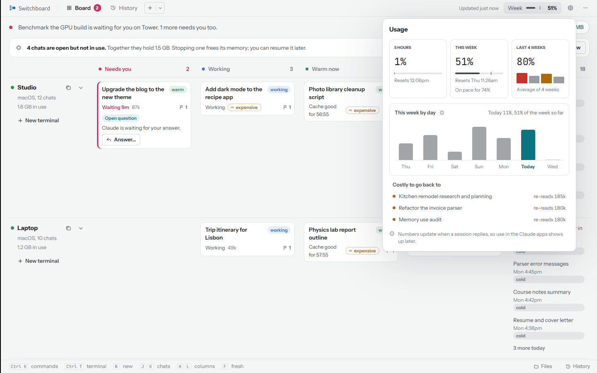
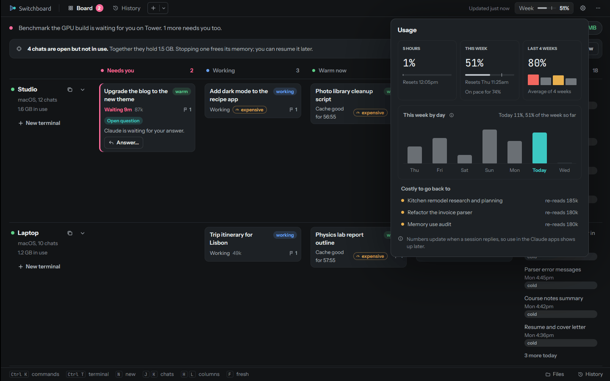

# Usage and budget

The **Week** chip in the header opens **Usage**.

<figure markdown>
{ .shot }
{ .shot }
</figure>

| | |
|---|---|
| **5 hours** | How much of the 5-hour window you've used, and when it resets |
| **This week** | How much of the week, when it resets, and where you'll end at this rate |
| **Last 4 weeks** | The average of how the last four weeks ended |
| **This week by day** | A bar for each day since the reset, today in color, against your daily budget |
| **Costly to go back to** | The biggest cold chats (150k tokens or more), with what they would re-read |

The numbers are your plan's own, as Claude Code reports them in its status line on each computer; the newest
report from any computer wins. They move when a chat replies, so what you use in the Claude apps shows up a
little later.

## Daily budget

**Settings, Budget** sets how much of the week a day should use. The default, 14.3%, spreads the week evenly over
seven days. When a day goes over it, Switchboard tells you, and each chat mentions it to you once.

Near the weekly reset, the budget **gives way**: a day may use whatever room is left divided by the days left,
when that is more than the budget. So the last days of a week can use what earlier days saved. A **5-hour cap**
works the same way for the 5-hour window (off unless you set one).

## Hard limit

Off unless you turn it on, in **Settings, Budget, Hard limit**, with a daily limit (20% to start) and an optional
5-hour limit (off until you set one). When a limit is reached:

- new messages in every chat are blocked, with a line that says why and how to lift it;
- running background chats are stopped, once a day. They can be resumed. Chats open in a terminal are left
  running, and their next message is blocked;
- your iPhone gets **Hard limit hit**, if notifications are set up.

**Lift for today** turns it off until midnight.
